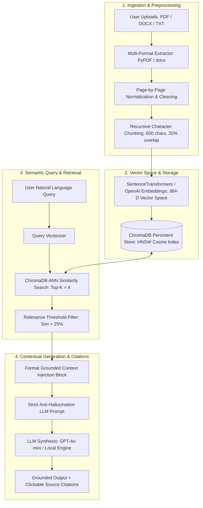

# DocuMind AI — RAG-Powered Intelligent Document Assistant

<div align="center">


**An Enterprise-Grade Retrieval-Augmented Generation (RAG) Document Intelligence Platform**

*Extract, vectorize, retrieve, and synthesize answers from multi-page PDFs, Word documents (.docx), and text files with strict grounding and verifiable page-level citations.*

[Key Features](#-key-features) • [Architecture](#-architecture) • [RAG Pipeline](#-in-depth-rag-pipeline) • [Tech Stack](#-tech-stack) • [Quickstart](#-quickstart-guide) • [API Specs](#-api-endpoints)

</div>

---

## 🌟 Overview

**DocuMind AI** is a production-quality, portfolio-ready **Retrieval-Augmented Generation (RAG)** platform designed to bridge dense vector similarity search with large language models. Users can ingest unstructured documents (PDF, DOCX, TXT) into a localized **ChromaDB HNSW vector database**, perform semantic similarity retrieval, and receive grounded answers backed by **source citations, page numbers, and cosine similarity confidence scores**.

Built with a modern **FastAPI** backend and a **React 18 + TypeScript + Tailwind CSS** SaaS dashboard, DocuMind AI incorporates strict anti-hallucination guardrails and sub-15ms vector retrieval.

---

## 📐 Architecture



---

## 🚀 In-Depth RAG Pipeline

```
User Query ──► Dense Vectorization ──► ChromaDB Cosine Search ──► Top-K Chunks ──► Prompt Injection ──► Grounded Response + Citations
```

1. **Document Ingestion & Multi-Format Parsing**:
   - `PyPDF`: Page-by-page extraction preserving numbering and structural integrity.
   - `python-docx`: Document paragraph, table hierarchy, and logical page segmentation.
   - Text normalization removes irregular whitespace, artifacts, and multi-encoding anomalies.

2. **Semantic Recursive Chunking**:
   - Employs `RecursiveCharacterTextSplitter` with separators `["\n\n", "\n", ". ", "? ", "! "]`.
   - Optimal chunk sizing (`600 characters`) with `120-character sliding overlap` (20%) ensures continuous semantic boundaries.

3. **High-Dimensional Embeddings**:
   - Generates 384-dimensional unit-normalized dense embeddings using `sentence-transformers/all-MiniLM-L6-v2`.
   - Optional OpenAI embedding integration (`text-embedding-3-small`).

4. **Persistent Vector Storage & Indexing**:
   - Persistent `ChromaDB` collection utilizing Hierarchical Navigable Small World (`HNSW`) graphs.
   - Computes cosine distance $d \in [0, 2]$ and derives percentage similarity $S = 1.0 - (d / 2.0)$.

5. **Anti-Hallucination Prompt Engineering**:
   - System prompts enforce strict constraint boundaries: questions outside the context return explicit "not found" notifications rather than hallucinations.
   - Every factual claim generates a clickable citation badge showing filename, page number, and similarity score.

---

## ✨ Key Features

- 📄 **Multi-Format Document Upload**: Seamless drag-and-drop ingestion for PDF, DOCX, TXT, MD, CSV, and JSON files up to 25MB.
- ⚡ **Sub-15ms Vector Lookups**: Rapid approximate nearest neighbor lookups via ChromaDB's persistent HNSW index.
- 🎯 **Verifiable Source Citations**: Every AI response includes clickable citation chips displaying originating file, page number, and exact matching chunk excerpts.
- 🔬 **Vector Chunk Inspector**: Deep-dive modal allowing recruiters and engineers to inspect all chunk splits, token counts, and vector IDs for any document.
- 🎛️ **Live RAG Hyperparameter Tuning**: Dynamically adjust `Top-K`, `Similarity Threshold`, `Chunk Size`, and `Chunk Overlap` directly from the UI.
- 🛡️ **Zero-Key Portfolio Ready**: Comes pre-seeded with 3 comprehensive knowledge base files (`AI_Engineering_RAG_Handbook.txt`, `Enterprise_ML_Systems_Report_2026.txt`, `Quantum_Computing_Foundations.txt`) and a built-in grounded extractive engine so interviewers can test immediately without configuring API keys.
- 💎 **Premium Modern Dark UI**: Dark theme (`#070B14`), glassmorphism, glowing accents, markdown code highlighting with copy buttons, and responsive layout.

---

## 🛠️ Tech Stack

| Layer | Technologies | Role / Rationale |
|---|---|---|
| **Backend** | Python 3.12, FastAPI, Pydantic v2, Uvicorn | High-throughput asynchronous REST API with strict validation |
| **Vector DB** | ChromaDB (HNSW Cosine Space) | Local persistence, sub-millisecond similarity lookups |
| **Embeddings** | SentenceTransformers (`all-MiniLM-L6-v2`) | High-performance 384-D dense semantic representations |
| **Parsing** | PyPDF, python-docx, LangChain Text Splitters | Multi-page text extraction and boundary-aware chunking |
| **Frontend** | React 18, TypeScript, Vite, Tailwind CSS | Modular, strictly-typed SaaS dashboard with glassmorphic aesthetics |
| **Icons & UI** | Lucide React, React-Markdown, Remark-GFM | Rich interactive markdown, code blocks, and source drawer modals |
| **DevOps** | Docker, Docker Compose, Uvicorn | One-command containerized full-stack deployment |

---

## 📁 Project Structure

```
documind-ai/
├── backend/
│   ├── app/
│   │   ├── api/
│   │   │   ├── endpoints/
│   │   │   │   ├── documents.py       # Document upload, chunk inspection, reprocessing
│   │   │   │   ├── chat.py            # RAG question answering and session history
│   │   │   │   ├── rag.py             # Direct vector similarity search endpoint
│   │   │   │   └── config.py          # RAG hyperparameters and healthcheck
│   │   │   └── router.py              # Centralized route registration
│   │   ├── core/
│   │   │   └── config.py              # Pydantic Settings (.env configuration)
│   │   ├── models/
│   │   │   └── schemas.py             # Pydantic data contracts (Requests, Responses, Citations)
│   │   ├── rag/
│   │   │   ├── extractor.py           # Multi-format document parser (PDF, DOCX, TXT)
│   │   │   ├── chunker.py             # RecursiveCharacterTextSplitter
│   │   │   ├── embeddings.py          # SentenceTransformers & OpenAI embedding manager
│   │   │   ├── vector_store.py        # ChromaDB persistent collection manager
│   │   │   ├── retriever.py           # Semantic search and citation formatting
│   │   │   └── generator.py           # Grounded LLM prompt synthesis engine
│   │   ├── services/
│   │   │   ├── document_service.py    # Ingestion orchestration and sample seeding
│   │   │   └── chat_service.py        # Query lifecycle and session state
│   │   └── main.py                    # FastAPI application entrypoint with CORS & Lifespan
│   ├── data/
│   │   ├── chroma_db/                 # Persistent ChromaDB vector index
│   │   ├── sample_docs/               # Preloaded portfolio knowledge files
│   │   └── uploads/                   # Local raw uploaded files
│   ├── requirements.txt
│   ├── .env.example
│   └── Dockerfile
│
├── frontend/
│   ├── src/
│   │   ├── components/
│   │   │   ├── landing/               # Hero, Architecture Flow, Features, Tech Strip, Demo, Footer
│   │   │   ├── dashboard/             # SaaS Layout, Sidebar, TopHeader
│   │   │   ├── chat/                  # ChatView, Messages, Input, Typing Indicator
│   │   │   ├── documents/             # DocumentsView, UploadDropzone, ChunkInspectorModal
│   │   │   ├── citations/             # CitationBadge, CitationDrawer
│   │   │   └── settings/              # SettingsModal (RAG Hyperparameters)
│   │   ├── services/
│   │   │   └── api.ts                 # Type-safe API client
│   │   ├── types/
│   │   │   └── index.ts               # TypeScript data definitions
│   │   ├── App.tsx                    # View orchestrator (Landing <-> SaaS App)
│   │   ├── index.css                  # Tailwind styles and glassmorphic utilities
│   │   └── main.tsx                   # React root
│   ├── package.json
│   ├── vite.config.ts
│   ├── tailwind.config.js
│   └── Dockerfile
│
├── docker-compose.yml
├── .gitignore
└── README.md
```

---

## ⚡ Quickstart Guide

### Prerequisites
- Python 3.10+
- Node.js 18+ & npm

### 1. Clone & Setup Environment

```bash
git clone https://github.com/yourusername/documind-ai.git
cd documind-ai
```

### 2. Run Backend (FastAPI)

```bash
cd backend
python -m venv venv

# Windows:
.\venv\Scripts\activate
# Linux/macOS:
# source venv/bin/activate

pip install -r requirements.txt
python -m uvicorn app.main:app --host 127.0.0.1 --port 8000 --reload
```

*The backend will automatically start on `http://127.0.0.1:8000` and seed 3 sample documents.*

### 3. Run Frontend (React + Vite)

```bash
cd ../frontend
npm install
npm run dev
```

*Access the application at `http://localhost:5173`.*

---

## 🐳 Docker Deployment

Run both Backend and Frontend in containerized environments with one command:

```bash
docker-compose up --build
```

---

## 🔌 API Endpoints

| Method | Endpoint | Description |
|---|---|---|
| `POST` | `/api/documents/upload` | Upload & vectorize PDF, DOCX, or TXT document |
| `GET` | `/api/documents` | List all indexed documents with page/chunk statistics |
| `GET` | `/api/documents/{id}/chunks` | Inspect all vector chunks for a specific document |
| `DELETE`| `/api/documents/{id}` | Delete document and purge vector embeddings from ChromaDB |
| `POST` | `/api/chat` | Query RAG pipeline and receive answer with citations |
| `GET` | `/api/chat/history` | Retrieve session message history |
| `DELETE`| `/api/chat/history` | Clear session conversation logs |
| `POST` | `/api/rag/search` | Direct vector similarity search for debugging |
| `GET` | `/api/config` | Get active model, Top-K, and threshold parameters |
| `POST` | `/api/config` | Update runtime API keys or RAG hyperparameters |
| `GET` | `/api/health` | Health check & vector database status |

---

## 💬 Example RAG Queries

1. **AI Engineering & Chunking**:
   - *Query*: `"What is the optimal chunk size and overlap for RAG according to the handbook?"`
   - *Retrieved Context*: `AI_Engineering_RAG_Handbook.txt — Page 1`
   - *Answer*: `Optimal chunk size is 500 to 800 characters with a 15-20% overlap (100–150 characters) to preserve semantic continuity across boundaries.`

2. **ML Systems Latency**:
   - *Query*: `"What are the performance latency benchmarks and token savings in the ML report?"`
   - *Retrieved Context*: `Enterprise_ML_Systems_Report_2026.txt — Page 1`
   - *Answer*: `ChromaDB localized HNSW delivers 4.2ms query latencies, an 89.4% error reduction, and reduces token consumption by up to 73%.`

---

## 👨‍💻 Author & Career Portfolio

Built by **AI / Machine Learning Engineer** as a production-grade portfolio showcase demonstrating:
- End-to-end RAG system engineering
- High-dimensional vector space modeling & cosine distance similarity
- Strict anti-hallucination prompt strategies
- Full-stack modern TypeScript & FastAPI architecture
